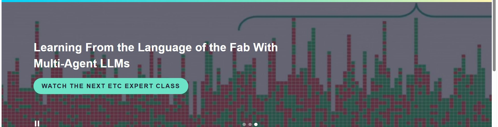
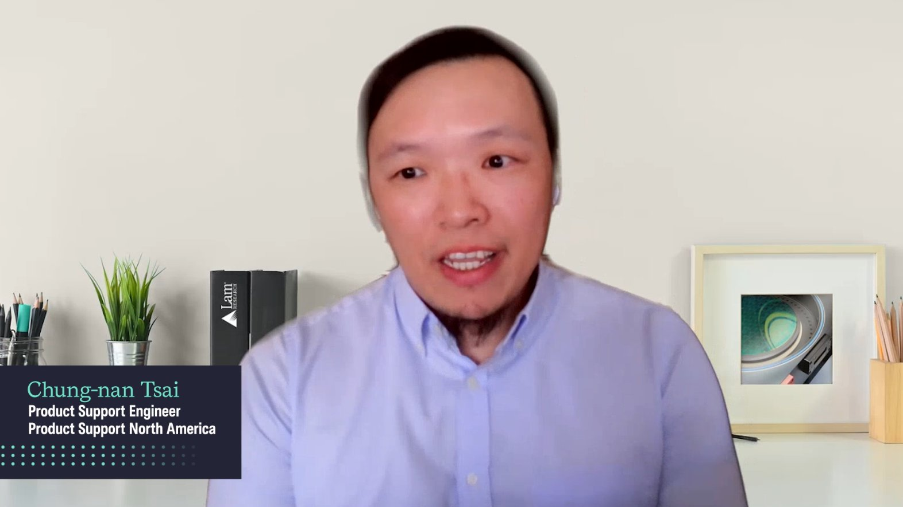

🏭 Honored to have my research, *"Learning From the Language of the Fab With Multi-Agent LLMs,"* featured on Lam Research's internal communications platform, **The Point**!

Great to see work on multi-agent LLM reasoning for semiconductor fabs recognized company-wide. 🙌

{:.img-fluid.rounded}

{:.img-fluid.rounded}
